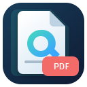

<h1 align="center">qmd2pdf</h1>

  

This VS Code extension opens Quarto's live preview for the active `.qmd` file
in a VS Code editor beside the document. Quarto watches the document and its
resources and rerenders changes.

## Requirements

- [Quarto](https://quarto.org/docs/get-started/) installed and available as
  `quarto` on `PATH`.
- A saved `.qmd` file.

## Use

Open a `.qmd` file and select **qmd2pdf: Start Live Preview** from the
Command Palette or use the play button in the editor title. The preview opens
beside the document. Use **qmd2pdf: Stop Live Preview** or close the
preview tab to stop it.

Use **Save PDF As...** in the preview toolbar to save the latest rendered PDF
to a location selected in the native save dialog.

Each preview gets a temporary isolated copy of the Quarto project. Quarto
renders the copied document and writes generated files there, leaving the
original project untouched. The active editor's QMD contents are synchronized
to the copy only when you save, so unsaved edits do not trigger a render.
Project settings,
Lua filters, and other project files are copied too; common generated and
dependency directories are excluded. The temporary copy is removed when the
preview closes.

Project-local `_quarto.yaml` (or `_quarto.yml`) and `filter.lua` are preserved
and used when present. The extension supplies its global YAML or Lua filter
only when that corresponding project file is missing. On first use, editable
copies of the bundled defaults are created in the extension's global storage. Run
**qmd2pdf: Open Preview Config Files** from the Command Palette to open both files
for editing. Changes apply to previews started after the files are saved.
Alternatively, set **qmd2pdf: Config Directory** in VS Code Settings
to a directory containing your own `_quarto.yaml` and `filter.lua`.
Existing global config files are migrated from the previous extension on
first use.

## Development

Run `npm install` and `npm run compile`, then press F5 in VS Code to launch an
Extension Development Host.

To create a local installable `.vsix` package, run `npm install` and
`npm run package`. Install the resulting `.vsix` from
VS Code's Extensions view using **Install from VSIX...**.

> Vibed with copilot